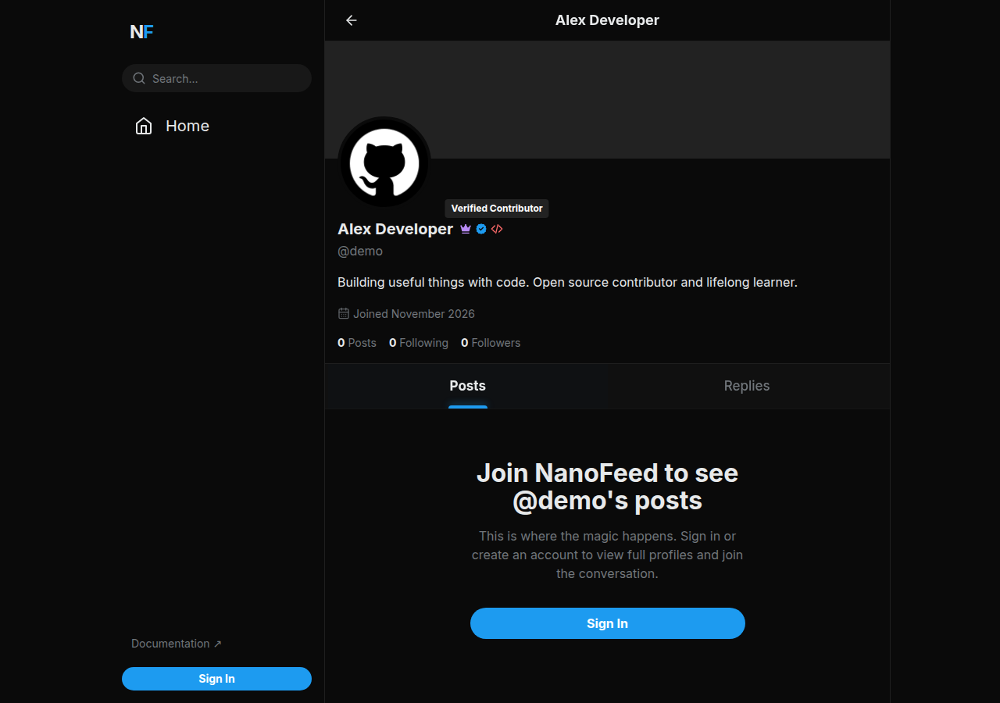
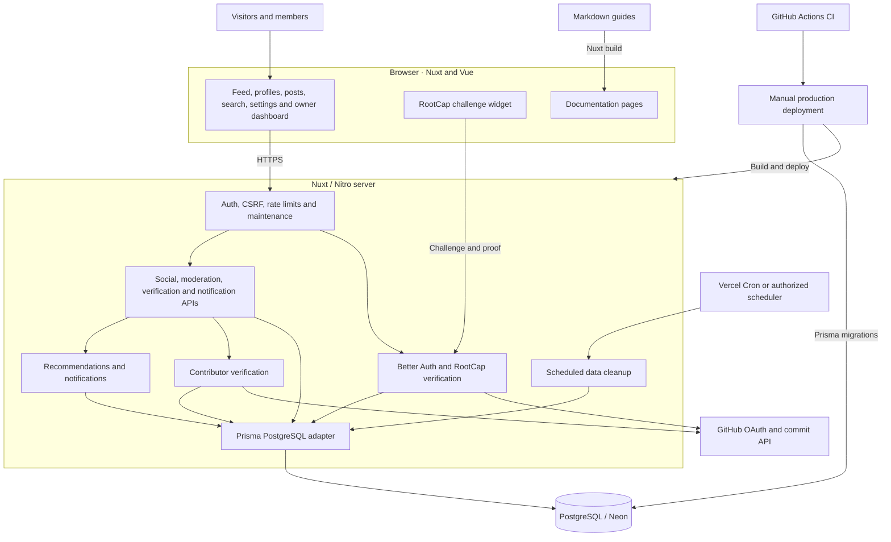

# NanoFeed

A text-first developer social network built with Nuxt, Vue, Better Auth, Prisma, and Neon PostgreSQL. GitHub is the only sign-in provider.

[](https://github.com/nanofeed/nanofeed/actions/workflows/ci.yml)

Live platform: [nanofeed](https://nanofeed.vercel.app/) · [Documentation](https://nanofeed.vercel.app/docs)

Official repository: [nanofeed/nanofeed](https://github.com/nanofeed/nanofeed).

## Screenshots

### Sign in

The live [NanoFeed home page](https://nanofeed.vercel.app/) directs visitors to GitHub sign-in.


### Profile

This screenshot shows a public profile with synthetic demo data from a local production build.



### Home feed

The feed requires sign-in. This screenshot uses a local production build with synthetic demo accounts and posts.

**For you**


**Latest**


## Architecture



The browser talks to Nuxt server routes. Better Auth and RootCap handle GitHub sign-in, while Prisma stores application data in PostgreSQL. Recommendations run in the server; documentation is bundled from Markdown during the build.

## User guides

Start with [Connect with developers](docs/CONNECTING.md), [Posts and conversations](docs/CONVERSATIONS.md), [Using NanoFeed](docs/USING-NANOFEED.md), [Account and privacy](docs/ACCOUNT.md), and [Troubleshooting](docs/TROUBLESHOOTING.md). The public docs website includes searchable guides, section navigation, and copyable code examples with language headers.

## Features

- GitHub sign-in, editable profiles, follows, posts, replies, reactions, and reposts.
- **For you:** recommendations using freshness, engagement, followed authors, topic affinity, and author diversity, with an explanation on each post.
- Following and chronological Latest feeds.
- Owner moderation, verification, notifications, and account deletion with a 30-day grace period.

## Start locally

Use **Node 24** and npm. Create a Neon database and GitHub OAuth app using the [complete setup and deployment guide](docs/DEPLOYMENT.md).

```bash
git clone https://github.com/nanofeed/nanofeed.git
cd nanofeed
cp .env.example .env
# Fill in the database URLs, auth secret, app URL, GitHub credentials, and cron secret.
npm ci
npm run db:deploy
npm run dev
```

Open `http://localhost:3000`. A database and GitHub OAuth app are required for a real sign-in. No seed is necessary; `OWNER_GITHUB_ID` grants the owner role at login.

**Existing installations:** read the migration section before running `db:deploy`. The migration preserves user IDs and content, converts GitHub account bindings, and deliberately signs everyone out.

## Format locally

```bash
npm run format       # format supported project files with Prettier
npm run format:check # check formatting without changing files
```

Run the formatter before committing. Generated files, dependencies, database dumps, lockfiles, and migration SQL are excluded.

## Verify and build

```bash
npm run lint
npm run typecheck
npm test
npm run build
# DATABASE_URL must point to a disposable, migrated PostgreSQL test database:
npm run test:integration
npm audit --audit-level=moderate
```

Integration tests simulate GitHub responses and exercise the real Better Auth flow, PostgreSQL migrations, and built HTTP server. They create and delete synthetic fixtures and must never target production.

```bash
npm run build                    # portable Node server
node --env-file=.env .output/server/index.mjs
NITRO_PRESET=vercel npm run build # Vercel output
```

See [deployment and environment setup](docs/DEPLOYMENT.md), [recommendation design](docs/RECOMMENDATIONS.md), and [upgrade notes](docs/UPGRADES.md). GitHub Actions includes CI, a manually dispatched production deployment that runs CI before migration/deployment, and a scheduled or manually dispatched keepalive workflow.

## Publish documentation

Guides and blog-style articles live in `docs/*.md` and appear at `/docs/<filename-in-lowercase>`. Add YAML frontmatter, write standard Markdown, and commit the file on GitHub. The docs site updates on the next deployment. See the [writing guide](docs/WRITING.md), [migration runbook](docs/MIGRATION.md), [GitHub OAuth setup](docs/GITHUB-AUTH.md), and [Neon setup](docs/NEON.md). No content database or seed is required.

## Project direction and contributions

Read the [roadmap](docs/ROADMAP.md) for the current baseline and proposed priorities. See [Contributing](docs/CONTRIBUTING.md) to report a bug, suggest an improvement, or prepare a pull request for [nanofeed/nanofeed](https://github.com/nanofeed/nanofeed).

## License

MIT. See [LICENSE](LICENSE).
