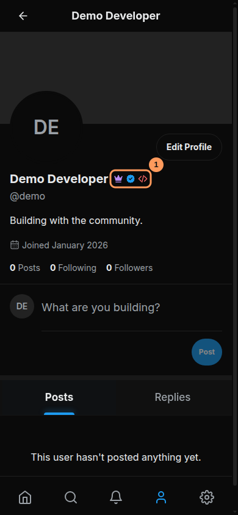
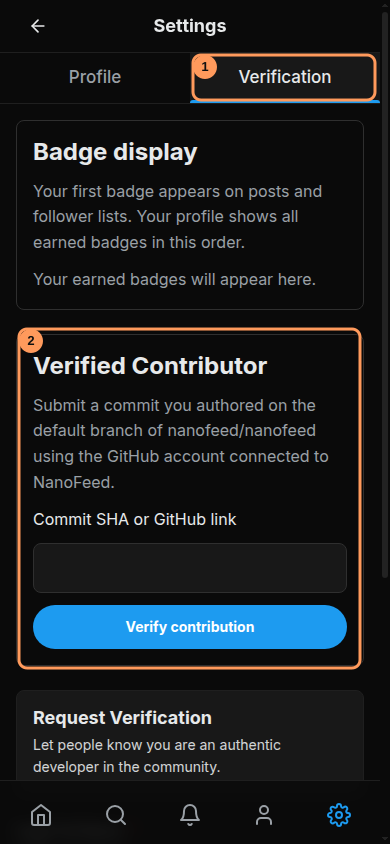
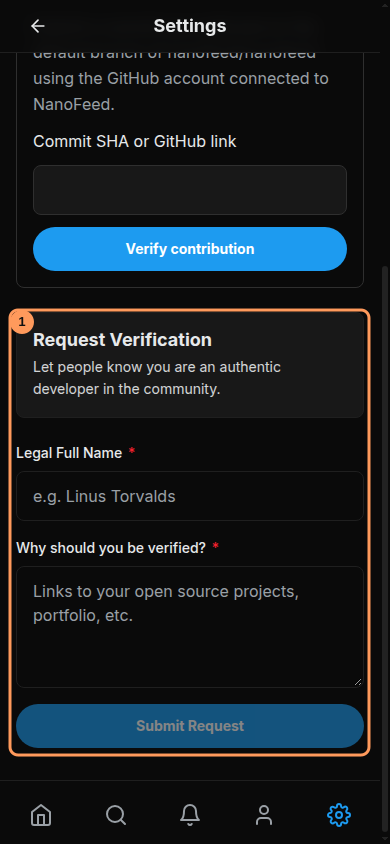

# Badges and verification

NanoFeed currently has three badges. They describe different roles or achievements and can appear together. The example screenshots use a local installation with synthetic accounts; they do not show a real claim or approval.

The marked example shows a **purple crown** (Project Owner), **blue check** (Verified Developer), and **red code brackets** (Verified Contributor). Tap or focus a badge to see its name. An account only shows badges it has earned. More badges may be introduced in the future; current eligibility is described below.

## Project Owner

The crown identifies an account with the installation's owner role. It is assigned by the installation's configured GitHub ID (`OWNER_GITHUB_ID`); it is not a public application or a contributor reward. An owner can manage the site and review reports and verification requests. For setup details, see [Build and deploy](DEPLOYMENT.md).

## Verified Contributor

This badge is available to any eligible account, including the owner. The commit must be attributed by GitHub to the GitHub account connected to NanoFeed and reachable from the default branch of the official [nanofeed/nanofeed](https://github.com/nanofeed/nanofeed) repository. A fork or an unmerged branch alone does not qualify.

1. Sign in with the GitHub account shown as the commit author.
2. Open **Settings → Verification** (1 below).
3. Under **Verified Contributor** (2), enter a commit SHA of 7–40 hexadecimal characters, or its `https://github.com/nanofeed/nanofeed/commit/…` link. Choose **Verify contribution**.
4. The server checks GitHub attribution and default-branch membership. A match grants the badge automatically; a mismatch does not. Check the displayed message and refresh author data if needed.

The claim is limited to five attempts per account per minute. GitHub attribution is based on commit metadata and is not cryptographic proof of authorship. For authorization or rate-limit errors, see [Troubleshooting](TROUBLESHOOTING.md#my-contributor-badge-was-not-granted).

## Verified Developer

The blue check is granted after an owner reviews and approves a developer verification request. It is separate from the contributor claim; submitting an application does not grant it automatically.

1. Open **Settings → Verification**, then scroll to **Request Verification** (1 below).
2. Enter your legal full name and a reason of at least 20 characters. Include useful context such as a portfolio or open-source work. The request uses your account email.
3. Choose **Submit Request**. Settings shows when an application is pending; check notifications and return to the Verification tab for its status.
4. The owner decides whether to approve it. Only one request can be pending at a time. If applications are closed, wait until they reopen. If verification was removed, a seven-day waiting period applies before reapplying.

## Choose which badge appears first

In **Settings → Verification → Badge display**, use the up and down controls and choose **Save badge order**. Your profile shows all earned badges in that order. Posts, replies, search results, and follower/following lists show the first eligible badge. Without a saved preference, the order is Owner, Developer, Contributor. Newly earned badges follow saved eligible badges in default order; badges no longer earned are hidden.

For account settings and moderation, see [Account and privacy](ACCOUNT.md). A badge does not exempt an account from the platform's rules.
