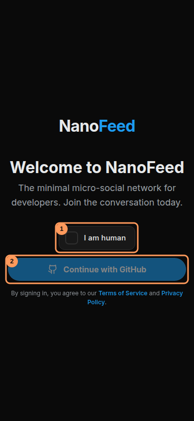
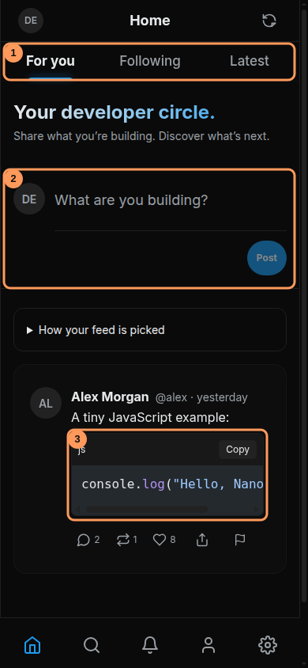

# Using NanoFeed

NanoFeed is a text-first place to share what you are building. Open [the feed](https://nanofeed.vercel.app/) to explore. The official project repository is [nanofeed/nanofeed](https://github.com/nanofeed/nanofeed).

## Sign in and set up your profile

1. Open [NanoFeed](https://nanofeed.vercel.app/). Choose **I am human** and complete the check (1). The GitHub button becomes available after the check succeeds.
2. Choose **Continue with GitHub** (2). Sign in to GitHub if asked and authorize NanoFeed. Use a GitHub account with an email available to the OAuth app.
3. Your first successful sign-in creates a profile. Use the same GitHub account when returning. Open **Settings → Profile** to update your display name, username, avatar, and bio.
4. Usernames use 3–30 letters, numbers, or underscores and must be available. Bios can contain up to 160 characters. Save your changes.



_Local demonstration. Complete the human check before choosing the disabled button._

Your NanoFeed profile edits remain when you sign in again. Changing your username also changes your profile URL, so update links you have shared. If sign-in fails, see [Troubleshooting](TROUBLESHOOTING.md#i-cannot-sign-in).

## Write your first post

On **Home**, type in **What are you building?** (2 in the image below), then choose **Post**. You can also post from the composer on your own profile. On desktop the sidebar **Post** button opens a composer. Press **Ctrl+Enter** on Windows/Linux or **Command+Enter** on macOS to submit from the composer.



_Local demonstration using synthetic accounts and a sample post._

Posts and replies must contain text and are limited to **280 characters**, including spaces, hashtags, and code fences. The counter appears as you type. Leading and trailing whitespace is trimmed. Posts and replies share a limit of five creation requests per account per minute; wait and retry if limited.

For example:

```text
Shipped my first Nuxt app today! Learning about server rendering next. #nuxt #buildinpublic
```

### Share code in a post

Type three backticks, an optional language name, and a newline. Put your code below, then close the block with three backticks. For example, type:

````text
```js
console.log("Hello, NanoFeed!")
```
````

A closed block appears with a language header and **Copy** control (3 above). An unfinished fence stays as text. The entire post, including the backticks and language, counts toward the limit; link to a repository for longer examples. For more on replies and sharing, see [Posts and conversations](CONVERSATIONS.md).

## Choose a feed

| Feed      | What to expect                                                                                                                                  |
| --------- | ----------------------------------------------------------------------------------------------------------------------------------------------- |
| For you   | Recommendations based on recent content, engagement, follows, and topic interests. Read the explanation on a post to understand the suggestion. |
| Following | Posts from people you follow. Visit a profile and choose Follow to build your circle.                                                           |
| Latest    | A chronological view of recent posts.                                                                                                           |

The three tabs are marked 1 in the Home image. New accounts may have little personalized history. Follow developers and interact with relevant posts; choose **Latest** for chronological posts. Refresh creates a new **For you** ranking. See [Content recommendations](RECOMMENDATIONS.md) for ranking and pagination details.

## Reply, react, repost, and share

Use the actions beneath a post to reply, react, repost, or share its link. Repeating the repost action removes your repost. You can delete your own post using its delete action and confirmation dialog; deletion cannot be undone.

Use **Search** to look for people, posts, and hashtags. Choose a hashtag on a post to browse that topic. Open **Notifications** to catch up on activity involving your account.

## Report a problem

Use the report action on another person's post. Select a reason, add useful context if needed, and choose **Submit Report**. The owner reviews reports; submitting one does not automatically remove the post.

For an application bug, use [the official issue tracker](https://github.com/nanofeed/nanofeed/issues). Include what you expected, what happened, and steps to reproduce it. Keep credentials and personal information out of public reports.

For a step-by-step walkthrough, read [Connect with developers](CONNECTING.md) and [Posts and conversations](CONVERSATIONS.md).

## Next steps

Read [Account and privacy](ACCOUNT.md) for verification, restrictions, deactivation, and deletion, or [Troubleshooting](TROUBLESHOOTING.md) if something does not work. To run your own installation, start with [Getting started](GETTING-STARTED.md).
